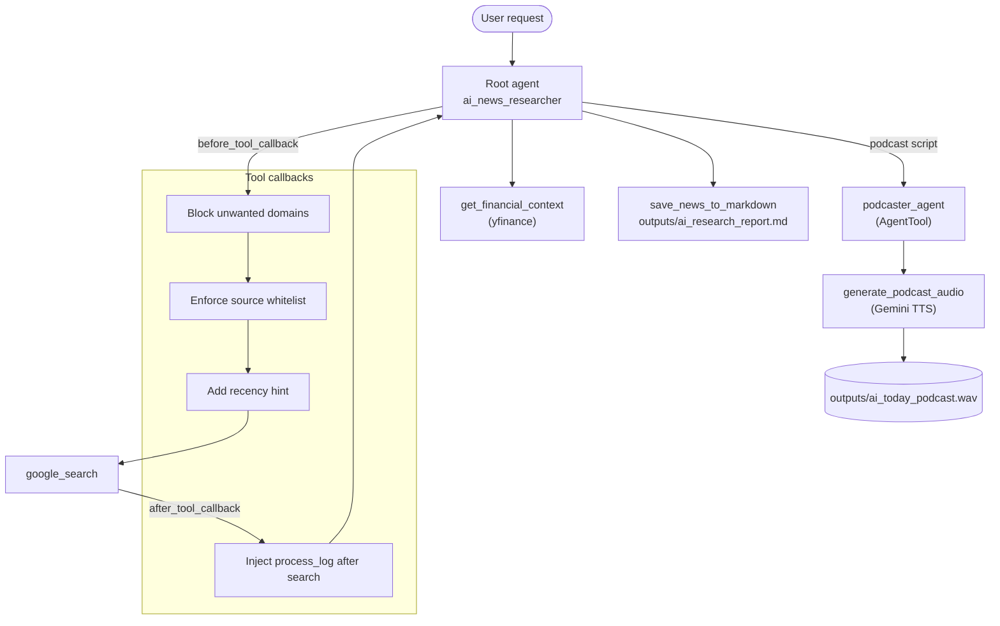

# 🎙️ AI News Podcast Agent

A multi-agent system built with **Google ADK** and **Gemini** that researches the latest AI news for NASDAQ-listed companies, enriches it with live stock data, saves a structured report, and produces a **two-host podcast** (Joe & Jane) as an audio file.


> **Demo:** _add a screenshot of the ADK Web UI or a link to a sample podcast here_
> ``

---

## What it does

1. You ask for the latest AI news (by text or live voice in the ADK Web UI).
2. The **root agent** searches trusted news sources with Google Search.
3. It extracts company tickers and fetches live prices and daily change via **yfinance**.
4. It builds a validated, structured report (**Pydantic** schema) and saves it as Markdown.
5. It writes a conversational script for two hosts.
6. A **podcaster sub-agent** converts the script to multi-speaker audio with **Gemini TTS** and saves a `.wav` file.

## Features

- **Multi-agent orchestration:** a root agent delegates audio generation to a specialist agent exposed as a tool (`AgentTool`).
- **Custom function tools:** stock data lookup, report persistence, and TTS audio generation, each with type hints, docstrings and graceful error handling.
- **Structured output:** `AINewsReport` / `NewsStory` Pydantic schemas keep report fields consistent.
- **Guardrails via callbacks:**
  - blocks searches that target low-quality domains (Reddit, Quora, Wikipedia, etc.)
  - restricts queries to a whitelist of trusted tech-news sites
  - adds a recency hint to every search
  - records which domains were sourced in a `process_log` audit trail
- **Resilient workflow:** a missing ticker or failed price lookup never halts the pipeline.
- **Tests and evals:** unit tests for callbacks and tools, plus an eval harness for end-to-end runs.

## Architecture



## Tech stack

| Area | Tools |
|---|---|
| Agent framework | Google Agent Development Kit (ADK) |
| LLMs | Gemini 2.5 Flash, Gemini 2.5 Flash Native Audio (live voice), Gemini 2.5 Flash TTS |
| Data validation | Pydantic |
| Market data | yfinance |
| Testing | `unittest` |

## Project structure

```
ai-news-podcast-agent/
├── ai_news_podcast/            # ADK agent package
│   ├── __init__.py             # exposes the agent to `adk web`
│   ├── agent.py                # root_agent + podcaster_agent
│   ├── prompts.py              # agent instructions
│   ├── schemas.py              # Pydantic models (NewsStory, AINewsReport)
│   ├── callbacks.py            # guardrail callbacks
│   ├── config.py               # models, domains, voices, output dir
│   ├── .env.example            # copy to .env and add your API key
│   └── tools/
│       ├── financial.py        # get_financial_context (yfinance)
│       ├── storage.py          # save_news_to_markdown
│       └── audio.py            # generate_podcast_audio (Gemini TTS)
├── tests/                      # unit tests (callbacks, tools)
├── evals/                      # eval prompts, output checker, results template
├── docs/                       # screenshots / diagrams
├── outputs/                    # generated report + podcast (git-ignored)
├── requirements.txt
├── LICENSE
└── README.md
```

## Getting started

### Prerequisites
- Python 3.10+
- A Gemini API key from [Google AI Studio](https://aistudio.google.com/apikey)

### Install

```bash
git clone https://github.com/<your-username>/ai-news-podcast-agent.git
cd ai-news-podcast-agent

python -m venv .venv
source .venv/bin/activate        # Windows: .venv\Scripts\activate
pip install -r requirements.txt
```

### Configure

```bash
cp ai_news_podcast/.env.example ai_news_podcast/.env
# then edit ai_news_podcast/.env and set GOOGLE_API_KEY
```

### Run

From the repository root:

```bash
adk web --port 8001
```

Open the printed URL, pick **ai_news_podcast** in the agent dropdown, and try:

> "Create a podcast about the latest AI news from NASDAQ companies."

The default root model (`gemini-2.5-flash-native-audio-preview-09-2025`) supports **live voice** in the Web UI. For text-only use, set `ROOT_AGENT_MODEL=gemini-2.5-flash` in your `.env`.

### Output

Results are written to `outputs/`:

| File | Description |
|---|---|
| `ai_research_report.md` | Structured news report with market data and a *Data Sourcing Notes* section |
| `ai_today_podcast.wav` | Two-host podcast audio (Joe & Jane) |

## Configuration

All settings can be overridden with environment variables (see `ai_news_podcast/config.py`):

| Variable | Default | Purpose |
|---|---|---|
| `ROOT_AGENT_MODEL` | `gemini-2.5-flash-native-audio-preview-09-2025` | Root agent model |
| `PODCASTER_AGENT_MODEL` | `gemini-2.5-flash` | Podcaster sub-agent model |
| `TTS_MODEL` | `gemini-2.5-flash-preview-tts` | Text-to-speech model |
| `OUTPUT_DIR` | `outputs` | Where reports and audio are saved |

## Testing

```bash
python -m unittest discover -s tests -t . -v
```

Covers the domain blocklist (including a false-positive check), whitelist and freshness callbacks, process-log injection, ticker filtering, filename sanitisation and WAV writing.

## Evaluation

Because the agent is LLM-driven, quality is measured with repeatable test prompts rather than a single accuracy number.

- `evals/test_prompts.json`: 25 prompts across four categories (standard, off-topic, blocked-domain, edge cases)
- `evals/check_outputs.py`: checks the report and audio produced by a run
- `evals/results_template.csv`: log each run here

```bash
python evals/check_outputs.py --dir outputs
```

**Results** _(fill in from your own runs)_

| Metric | Result |
|---|---|
| End-to-end success rate | _x / 25_ |
| Schema-valid outputs | _x %_ |
| Blocked-domain prompts correctly rejected | _x / 8_ |
| Avg. generation time | _x s_ |
| Script faithfulness (manual review of N samples) | _x %_ |

## Limitations

- Depends on external services (Gemini, Google Search grounding, Yahoo Finance), so occasional failures are expected.
- yfinance is an unofficial API; prices may be delayed or unavailable.
- The preview Gemini audio and TTS models may change or be retired; use the environment variables above to switch models.
- Scope is limited to NASDAQ-listed US companies by design.
- Script faithfulness relies on prompt instructions and should be spot-checked.

## Roadmap

- [ ] Automated eval runner that drives the agent and logs metrics
- [ ] Stock price charts embedded in the report
- [ ] Configurable hosts, voices and episode length
- [ ] Scheduled daily episodes and RSS feed export
- [ ] Docker image

## Acknowledgments

Built while following the *Building AI News Podcast Agent with Google ADK* course material; the agent architecture, tools and guardrail patterns are adapted from it. This repo restructures the notebook code into a modular package and adds configuration, filename sanitisation, a tightened domain blocklist, unit tests and an evaluation harness.
_(Add a link to the course here.)_

## License

MIT, see [LICENSE](LICENSE).
